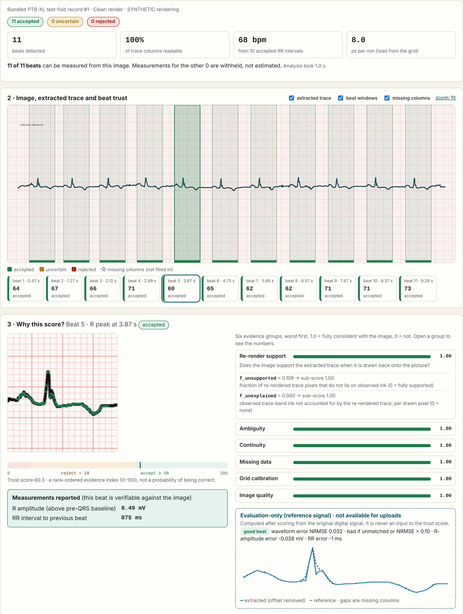
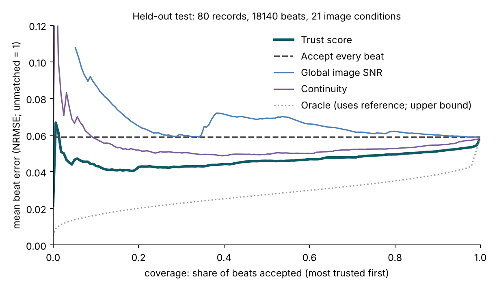
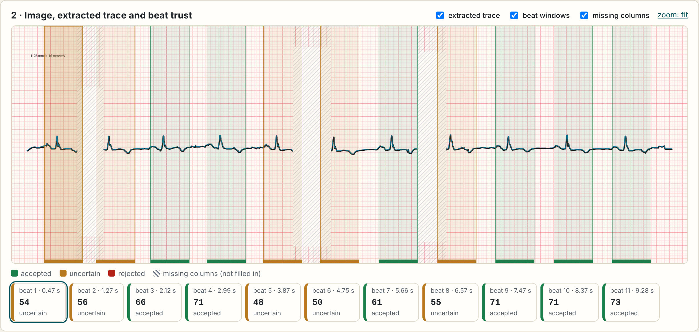
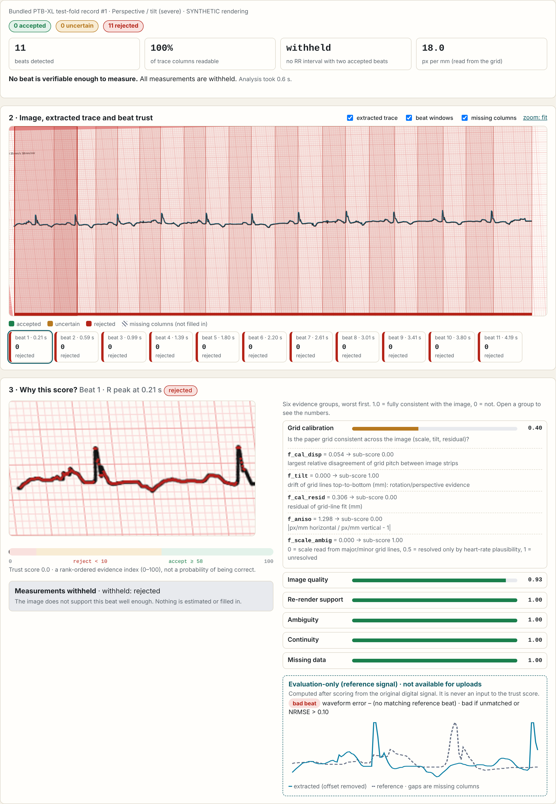
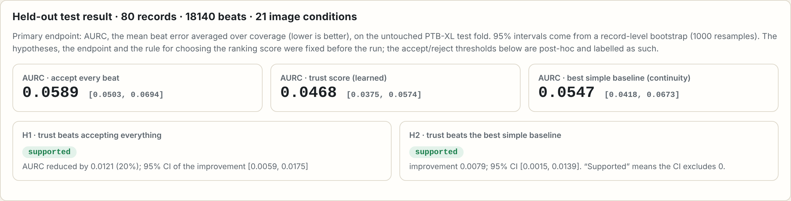
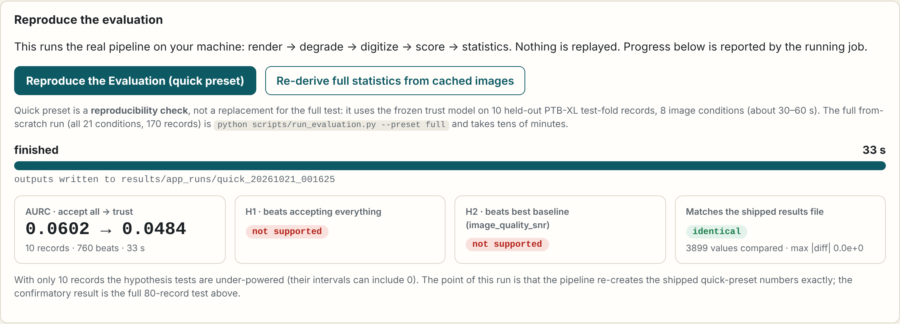

> **Built for the UnivaBio 2026 hackathon.**

<h1 align="center">ECG Trust Layer</h1>
<p align="center"><b>Which heartbeats of a digitized paper ECG can you still verify against the image?</b></p>

<p align="center">
  
  
  
  
  
</p>

> **Research prototype. Not a medical device. No clinical validation.** All images in this project are **synthetic renderings** of PTB-XL signals. They are not photographs of real paper ECGs, and performance on real images is unknown.

ECG digitizers turn a picture of a paper ECG into a signal, and then every downstream number is trusted blindly. **ECG Trust Layer adds the missing step:** for each heartbeat it asks *how well does the original image support this reconstruction?*, computes the answer **from the image alone** (no reference signal), and reports measurements **only for beats that are verifiable**. Anything else is withheld or returned as `unable`; nothing is filled in.

<p align="center"></p>

## Results at a glance

Held-out test: **80 PTB-XL records, 18,140 beats, 21 simulated image conditions** (the test fold was untouched until the final run). Primary endpoint: AURC, the mean beat error averaged over coverage (lower is better), with a record-level bootstrap.

| | AURC (95% CI) | |
|---|---|---|
| Accept every beat | 0.0589 (0.0503-0.0694) | |
| Best simple baseline (continuity) | 0.0547 (0.0418-0.0673) | |
| **Trust score** | **0.0468** (0.0375-0.0574) | |
| H1: trust beats accept-all | improvement 0.0121 (-20%), CI [0.0059, 0.0175] | **supported** |
| H2: trust beats best simple baseline | improvement 0.0079, CI [0.0015, 0.0139] | **supported, narrowly** (not supported on validation) |

At the operating point used by the app, **70% of beats are accepted with a 1.6% bad-beat rate (4.1% overall)**, and the reported R-amplitude / RR / heart-rate tails shrink.

### What did not work (reported honestly)

- **The pre-registered operating-point rule was vacuous.** It accepted every beat, because the overall bad-beat rate (4.1%) was already under its 5% target. We report it unchanged and added one clearly labelled **post-hoc** operating point (accepted bad-rate ≤ 1%, the digitizer's own floor on clean images).
- **No help for severe blur**, and **15% of accepted beats are still bad under severe thick-trace** conditions.
- **Withholding has a cost:** 30% of clean beats are withheld, and 23% of analyzable images have no reportable heart rate.
- Dropping the image-quality feature group *improved* the heuristic score; that group needs rethinking.
- **No real paper-ECG validation.** See [`docs/LIMITATIONS.md`](docs/LIMITATIONS.md) and the full account, including protocol deviations, in [`docs/REPORT.md`](docs/REPORT.md).



## The app

Run it locally (nothing leaves your machine; uploads are never written to disk):

```bash
python app/server.py            # http://127.0.0.1:5050
```

| Occluded trace: gaps are shown, never filled in | Tilted image: every beat rejected, measurements withheld |
|---|---|
|  |  |

| Evaluation tab: result, curve, operating points, negative results | Reproduce the Evaluation (a real run, real progress) |
|---|---|
|  |  |

**What you can do in it**
- Analyze a bundled example (10 held-out PTB-XL records × 8 image conditions) or **upload your own image** (PNG/JPEG).
- Inspect the original image, the extracted trace, and each beat's window coloured by decision (accepted / uncertain / rejected / unable). Missing columns are shown as explicit gaps.
- Open the **evidence inspector** for any beat: six evidence groups with every feature value and what it means.
- See gated measurements (R amplitude, RR interval, heart rate), reported only for accepted beats.
- For bundled examples, an **"evaluation-only"** panel compares with the original signal. It is clearly labelled, computed after scoring, and never an input to the score.
- **Reproduce the Evaluation** button: runs the real pipeline (render → degrade → digitize → score → statistics) with genuine progress (under a minute) and compares against the shipped results file. The 10-record run checks reproducibility; it is too small to test the hypotheses, and the app says so.

Supported input assumptions: one lead as a dark trace on light paper, a standard pink/red 1 mm / 5 mm grid, 25 mm/s and 10 mm/mV, roughly frontal view. If the grid or trace cannot be read, the result is `unable`.

## Quick start

```bash
git clone https://github.com/Abdullah49645/ecg-trust-layer.git
cd ecg-trust-layer
python -m venv .venv && source .venv/bin/activate      # Windows: .venv\Scripts\activate
pip install -r requirements.txt
pip install -e .                                       # optional; src/ is also on the path via the scripts

pytest -q                                              # 66 tests
python scripts/run_evaluation.py --preset quick        # ~30 s, frozen model, bundled data, no download
python app/server.py                                   # the web app
```

**Full evaluation from scratch** (170 records × 21 conditions, about 25 min on 2 cores):

```bash
python scripts/download_data.py --n-tune 60 --n-val 30 --n-test 80    # PTB-XL subset (~27 MB), CC BY 4.0
python scripts/run_evaluation.py --preset full --workers 2
python scripts/make_figures.py                                        # figures from results_full.json
```

Per-image results are cached in `results/raw/` (bundled), so re-deriving the statistics takes about 4.5 minutes and the app's "Re-derive full statistics from cached images" button works out of the box.

Outputs: [`results/results_full.json`](results/results_full.json) (machine-readable, includes environment, config hashes and the pre-registered protocol), `results/results_quick.json`, `results/trust_model.json` (frozen model), `results/feasibility_gate.json`.

## How it works

```
 paper-ECG image ──► grid calibration ──► trace extraction ──► beat detection ──► trust score per beat ──► gate
 (PNG/JPEG)          (px→mm, per strip)   (Viterbi, explicit    (R peaks,         (6 evidence groups,      accepted → measure
                                           "missing" state)      beat windows)     image-only)             otherwise → withheld / unable
```

1. **Calibrate** the paper grid per image strip (no assumed pixel size).
2. **Extract** the trace with a classical dynamic program that has an explicit *missing* state. Unreadable columns stay missing.
3. **Score each beat from the image only.** The extracted trace is drawn back onto the picture and compared with the observed ink, and five more evidence groups are checked:

| Group | Question |
|---|---|
| Re-render support | Does the image support the extracted trace? |
| Ambiguity | Were there competing ink strokes? |
| Continuity | Is the waveform physically smooth? |
| Missing data | Were columns unreadable (never filled)? |
| Grid calibration | Is the grid self-consistent (scale, tilt, residual)? |
| Image quality | Resolution, sharpness, ink-to-noise around the beat. |

4. **Gate:** measurements (R amplitude, RR interval, heart rate) only for accepted beats; an RR interval additionally needs a fully observed span between its two beats.

The trust score is a **rank-ordered evidence index (0-100), not a probability.** Method, protocol, and statistics: [`docs/REPORT.md`](docs/REPORT.md).

## Scientific integrity

- A **feasibility gate** was fixed before the evaluation (the extractor had to reproduce clean records: median NRMSE 0.032 against a ≤ 0.05 criterion; passed 60/60).
- Hypotheses, endpoint, splits (official PTB-XL folds, one record per patient, seed 2026) and the rule for choosing the operational score were pre-specified in [`configs/analysis_plan.json`](configs/analysis_plan.json); the later post-hoc operating point is in [`configs/analysis_addendum.json`](configs/analysis_addendum.json).
- The reference signal is **never** an input to the trust score (a structural test enforces it). There is no leakage between tune / validation / test.
- Deviations and process disclosures (RR definition fix, vacuous pre-registered operating point, a 6-record smoke run) are listed in [`docs/REPORT.md`](docs/REPORT.md#7-deviations-from-the-pre-registered-protocol-and-process-disclosures).

## Demo video

[`demo/ecg_trust_layer_demo.mp4`](demo/ecg_trust_layer_demo.mp4) is a screen recording of the real running app. The **narration is synthetic speech (Piper TTS, voice `en_US-lessac-medium`)**, not the author's voice, as the badge in the video states. The script, audio, timeline and the recorder are in [`demo/`](demo/); regenerate with `python demo/record_demo.py` (needs Playwright, Piper and FFmpeg; the voice model is not bundled, see [`demo/README.md`](demo/README.md)).

## Repository layout

```
app/                Flask app (server.py, templates/, static/)
src/ecgtrust/       render, degrade, extract, beats, trust, pipeline, evaluation, evalstats
scripts/            run_evaluation.py (one command), download_data.py, feasibility_gate.py, make_figures.py, make_screenshots.py
configs/            pre-registered plan, addendum, record selection, quick preset
data/quick/         10 bundled held-out PTB-XL records (CC BY 4.0)
results/            results_full.json, results_quick.json, trust_model.json, feasibility_gate.json, raw/ (cache)
docs/               REPORT.md, LIMITATIONS.md, NOVELTY.md, figures/, screenshots/
demo/               demo video, voice-over script/audio, timeline, recorder
tests/              66 automated tests (pytest)
```

## Data, licences and attribution

- **Code:** MIT ([`LICENSE`](LICENSE)). **Data:** PTB-XL v1.0.3, CC BY 4.0. Wagner et al., *Scientific Data* 7, 154 (2020), [doi:10.1038/s41597-020-0495-6](https://doi.org/10.1038/s41597-020-0495-6); PhysioNet [doi:10.13026/kfzx-aw45](https://doi.org/10.13026/kfzx-aw45). Changes: lead II only, first 10 s, converted to mV, and rendered to synthetic ECG-paper images by this project. Full notice in [`NOTICE.md`](NOTICE.md).
- Related work and an honest novelty assessment: [`docs/NOVELTY.md`](docs/NOVELTY.md).

## Author

Abdullah ([@Abdullah49645](https://github.com/Abdullah49645)), built for UnivaBio 2026.
