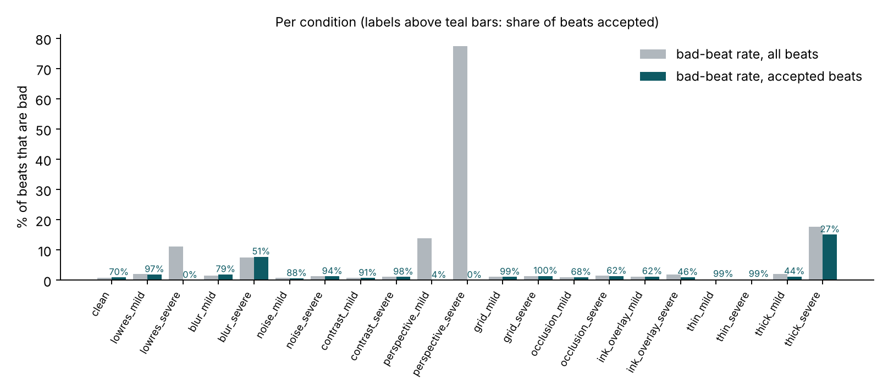

# ECG Trust Layer: beat-level trust scores for digitized paper ECGs

*Scientific report · built for UnivaBio 2026 · research prototype, not a medical device*

All numbers below are copied from `results/results_full.json` (generated by `python scripts/run_evaluation.py --preset full`); nothing is typed by hand. The figures are produced by `scripts/make_figures.py` from the same file.

## Abstract

ECG digitizers convert an image of a paper ECG into a signal, and downstream measurements then trust that signal everywhere. We add a reference-free **trust score for each heartbeat**: how well does the original image support the reconstruction of this beat? Measurements (RR interval, heart rate, R amplitude) are reported only for beats that are verifiable, and the tool says "unable" or "withheld" otherwise.

On a held-out test of 80 PTB-XL records (18,140 beats, 21 simulated image conditions, **synthetic renderings**), ranking beats by trust lowered the mean beat error from 0.0589 to 0.0468 (AURC, -20%; 95% CI of the improvement [0.0059, 0.0175]). The score also beat the best simple baseline (continuity), but only narrowly (improvement 0.0079, 95% CI [0.0015, 0.0139]). A post-hoc operating point accepts 70% of beats at a 1.6% bad-beat rate (4.1% overall). Our pre-registered operating-point rule was vacuous and did nothing; we report that unchanged. The score does not help for severe blur, and 15% of accepted beats are still bad under severe thick-trace conditions. There is no validation on real paper-ECG images and no clinical validation.

## 1. Problem

A digitizer's output looks equally plausible whether the image was crisp or badly degraded. The common evaluation practice compares against a reference signal. For example, the 2024 PhysioNet Challenge scored digitization by reference-based signal-to-noise ratio ([Reyna et al., Challenge 2024](https://moody-challenge.physionet.org/2024/papers/cinc_paper.pdf)). That is the right way to evaluate, but it is unavailable at deployment, where nobody has the reference. The question here is therefore: **can the image itself tell us which parts of the reconstruction to trust?**

## 2. Related work and an honest novelty assessment

- **Digitizers** exist and work well: for example a validated digitization algorithm for ECG paper images ([PMC9572306](https://www.ncbi.nlm.nih.gov/pmc/articles/PMC9572306/)) and AI-based high-precision digitization ([medRxiv 2024](https://www.medrxiv.org/content/10.1101/2024.08.31.24312876.full.pdf)). We do not claim to have invented a better digitizer; ours is deliberately a classical, transparent extractor.
- **Synthetic ECG images**: [ECG-Image-Kit](https://arxiv.org/abs/2307.01946) generates realistic synthetic and distorted ECG images. We use our own much simpler renderer (see limitations); ECG-Image-Kit and the challenge's real-image database would be the natural next test bed.
- **Selective prediction / risk-coverage**: our evaluation (risk-coverage curves, AURC) follows the selective-classification literature ([Geifman and El-Yaniv, 2017](https://arxiv.org/abs/1705.08500)). Known pitfalls of AURC are discussed in [Overcoming Common Flaws in the Evaluation of Selective Classification Systems](https://arxiv.org/abs/2407.01032); we mitigate with tie-aware AURC and report bad-beat rates at fixed coverages in addition.
- **Verdict.** Abstention and confidence scores are not new, and we do not claim them as inventions. In a limited (non-exhaustive) search, including the 2024 Challenge overview, we did not find a digitization study that reports a **reference-free, beat-level, image-grounded trust score tied to measurement gating**. The contribution is the combination: evidence computed from the image (re-rendering the extracted trace back onto the picture, ambiguity, continuity, missing columns, grid calibration, image quality), an explicit missing state that is never filled in, gated measurements, and an honest, pre-specified evaluation including negative findings.

## 3. Method

**Data.** PTB-XL v1.0.3 (CC BY 4.0), lead II, 500 Hz, first 10 s, in mV. Official `strat_fold` splits: tune folds 1-8 (60 records), validation fold 9 (30), test fold 10 (80); one record per patient; seed 2026. **Images are synthetic renderings** (25 mm/s, 10 mm/mV, 8 px/mm, 1/5 mm grid) with 21 conditions: clean plus {low resolution, blur, noise, contrast, perspective, dark grid, occlusion, ink strokes, thin trace, thick trace} × {mild, severe}. All degradations are seeded per record and condition.

**Extractor (classical, no learned components).** Per-strip grid calibration from peaks in median profiles, polynomial px-to-mm maps, grid-model subtraction restricted to calibrated line positions, adaptive threshold, connected-component filtering, and a Viterbi dynamic program over candidate ink runs with an explicit *missing* state. The absolute DC level of a printed trace is unobservable, so signals are median-centred. Unreadable inputs return status `unable`.

**Beats and measurements.** Simplified Pan-Tompkins R-peak detection with a polarity vote; beat window [R-0.2 s, R+0.4 s]. Measurements are limited to RR interval, heart rate and R amplitude above the pre-QRS baseline. An RR interval is reportable only if both bounding beats are accepted **and** the stretch between them was fully observed (see Section 7, item 1).

**Trust features (reference-free, 14 features in 6 groups).** *Re-render support* (the extracted trace is drawn back onto the image and compared to the observed ink), *ambiguity*, *continuity*, *missing data*, *grid calibration*, *image quality*. The reference signal is never an input; `tests/` include a structural test that the feature functions cannot accept one.

**Scores.** (a) Heuristic: piecewise-linear sub-scores between anchors derived from tune data (good = P90 of clean beats, bad = P98 of all beats), equal-weight geometric mean per group. (b) Learned: L2 logistic regression (C = 0.5, balanced) trained on tune. Trust = 100·(1-P(bad)) for the learned score. The operational score is the one with the lower AURC on validation (rule fixed in advance): here **learned**. The score is a rank-ordered evidence index, **not a calibrated probability**.

**Labels and error.** A beat is *bad* if it matches no reference beat (±100 ms) or its waveform NRMSE exceeds 0.10 after DC and lag alignment. Per-beat error is the NRMSE; unmatched beats get error 1.0.

**Feasibility gate (fixed before the evaluation).** The extractor had to reproduce the clean tune records before any trust claim: median NRMSE ≤ 0.05, P90 ≤ 0.10, median Pearson ≥ 0.98, coverage ≥ 0.98, HR error ≤ 2 bpm, R-amplitude error ≤ 0.10 mV. Result: **passed**, 60/60 records (median NRMSE 0.032, P90 0.045, median Pearson 0.983, median HR error 0.025 bpm, median R-amplitude error 0.016 mV).

**Statistics.** Primary endpoint: AURC on the test split (tie-aware; lower is better). Paired record-level bootstrap, 1,000 resamples (all conditions of a record resample together). H1: trust beats accept-all; H2: trust beats the best simple baseline (global image SNR, continuity, valid fraction). "Supported" means the 95% CI of the AURC improvement excludes zero. Baselines and per-group ablations are included; an oracle ranking by true error gives the achievable bound.

## 4. Results (held-out test; 80 records, 18,140 beats)

| Quantity | Value |
|---|---|
| AURC, accept every beat | 0.0589 (95% CI 0.0503-0.0694) |
| AURC, trust score (learned) | **0.0468** (0.0375-0.0574) |
| AURC, best simple baseline (continuity) | 0.0547 (0.0418-0.0673) |
| AURC, oracle (uses the reference; upper bound) | 0.0276 |
| H1: trust beats accept-all | **supported**: improvement 0.0121 (20%), CI [0.0059, 0.0175] |
| H2: trust beats best simple baseline | **supported, narrowly**: improvement 0.0079, CI [0.0015, 0.0139] |
| Bad-beat rate at 70% coverage | trust 1.6%; continuity 2.4%; accept-all 4.0%; image SNR 4.9% |

On validation (used to choose the operational score and thresholds), H1 was supported and H2 was **not** (improvement 0.0012, CI included zero). The test-set H2 result should therefore be read as modest and fragile, not as a robust win over a simple continuity check.

### 4.1 Operating points

| | Accepted | Uncertain | Rejected |
|---|---|---|---|
| **Post-hoc (used by the app)**, thresholds 10.5 / 57.8 | 70.0% of beats, bad-beat rate 1.6% | 27.4%, 6.7% | 2.6%, 42.6% |
| **Pre-registered** rule (accepted bad-rate ≤ 5%) | 99.8%, 4.1% | 0.2%, 2.3% | 0.0% |

The pre-registered rule was **vacuous**: the overall bad-beat rate (4.1%) is already below the 5% target, so accepting everything satisfied it and the decision layer did nothing. This is a negative result of our own protocol and is shown in the app. The post-hoc point (accepted bad-rate ≤ 1%, the digitizer's own floor of 0.8% on clean images in tune) was added after seeing that failure; its thresholds were chosen on validation and the test split was used once. See `configs/analysis_addendum.json`.

### 4.2 Do measurements improve when we gate them? (post-hoc operating point)

| Measurement | All matched | Accepted only |
|---|---|---|
| R amplitude, median / P90 abs. error | 0.018 / 0.048 mV (n = 17,655) | 0.016 / 0.037 mV (n = 12,398) |
| RR interval, median / P90 abs. error | 3.0 / 8.0 ms (n = 16,304) | 3.0 / 7.4 ms (n = 10,598) |
| RR interval, mean abs. error | 18.8 ms | 11.3 ms |
| Heart rate (per image), median / P90 | 0.03 / 6.53 bpm (n = 1,571) | 0.05 / 3.68 bpm (n = 1,205) |

Gating mainly removes tail errors; medians barely change. The cost is real: **366 of 1,571 analyzable images (23%) have no reportable heart rate** because no RR interval had two accepted bounding beats and a fully observed span.

### 4.3 Where it works and where it does not

- **Works:** severe perspective (62 of 80 images are refused as `unable`; for the rest 94% of beats are rejected), severe low resolution (all beats withheld), mild perspective (4% accepted).
- **Does not help:** *severe blur* (accepted bad-rate 7.7% vs 7.5% overall) and *severe thick trace* (15.1% of accepted beats are bad; only 27% of beats are accepted). Within these conditions the evidence features do not separate good beats from bad ones.
- **Cost on clean images:** only 70% of clean beats are accepted; 30% are withheld although their bad-beat rate is 0.9%.
- All 109 `unable` images are perspective conditions (47 mild, 62 severe).

### 4.4 Ablations and baselines

- Learned beats heuristic (AURC 0.0468 vs 0.0522).
- Dropping the *image quality* group **improved** the heuristic (0.0493 vs 0.0522): that group hurts as designed and should be revisited.
- The most informative single groups were *calibration* (0.0500 alone) and *continuity* (0.0530 alone); *rerender*, *ambiguity* and *missing* alone were close to accept-all.
- "Valid fraction" equals accept-all because almost no beat has missing columns in these conditions.
- Global image SNR is *worse* than accepting everything (0.0686): image-level quality is not a substitute for beat-level evidence.

## 5. Reproducibility

- `python scripts/run_evaluation.py --preset quick`: frozen model, 10 bundled held-out records, 8 conditions, about 30 s on 2 cores. Re-running reproduces `results/results_quick.json` exactly (3,899 values compared, maximum difference 0 in the app's "Reproduce the Evaluation" run). On 10 records the hypotheses are not testable (the quick-preset CIs include 0); it checks the pipeline, not the claim.
- `python scripts/run_evaluation.py --preset full`: from-scratch, 170 records × 21 conditions, about 25 min on 2 cores with downloaded data (`scripts/download_data.py`). Per-image results are cached in `results/raw/` (bundled), so re-deriving the statistics takes about 4.5 min.
- Everything is seeded; config hashes are stored in the results file. 66 automated tests.

## 6. Limitations (summary; full statement in `docs/LIMITATIONS.md`)

1. **Synthetic images only.** The renderer and the extractor share a pixel-grid model, which makes extraction easier than for real scans. Performance on photographs of real paper ECGs is unknown and likely worse.
2. The degradation mixture is chosen by us, so pooled numbers depend on it; per-condition numbers are more informative.
3. Single lead (II), 10 s, fixed layout, standard speed and gain assumed.
4. 80 test records from a single dataset; intervals are wide for H2.
5. The trust score is an evidence index, not a probability. No clinical validation; not for diagnosis.
6. Measurements are limited to RR, heart rate and R amplitude; DC offset is unobservable.

## 7. Deviations from the pre-registered protocol, and process disclosures

1. **RR definition fixed before any validation or test result existed.** A code review and regression test (`test_rr_never_spans_a_hidden_gap...`) showed that RR was computed to the previous *detected* beat, so a beat hidden by an occluded stretch produced a double-length RR, and the evaluation scored that against the interval between the same two detections (error 0, hiding the miss). Now (a) the reference RR is the interval to the *true* preceding beat, and (b) an RR is reportable only if the stretch between the two R peaks was fully observed. The tune split was reprocessed after this change.
2. **Vacuous operating point** (Section 4.1): reported as is; one post-hoc operating point added and labelled post-hoc. The first full run (pre-registered point only) is kept in `results/results_full_firstrun_prereg_only.json`. While choosing the post-hoc target, 2% and 5% were also inspected on the **validation** split.
3. **Smoke-run exposure.** During development a debug run on 6 test-fold records showed an AURC outcome on that tiny sample (H1 supported, H2 not). No design change was made from it. Extractor debugging otherwise used tune-split records and synthetic signals; I cannot rule out that individual validation or test-fold records were looked at during early debugging.
4. The extractor was developed against the same simulated degradations that are used to evaluate it, which can overstate performance on unseen kinds of degradation.

## 8. Intended use

Research on ECG digitization: deciding which reconstructed beats to include in an analysis, and exposing why. Not for diagnosis, triage or clinical decisions.

## 9. Data and attribution

PTB-XL v1.0.3, CC BY 4.0: Wagner et al., *Scientific Data* 7, 154 (2020), [doi:10.1038/s41597-020-0495-6](https://doi.org/10.1038/s41597-020-0495-6); PhysioNet [doi:10.13026/kfzx-aw45](https://doi.org/10.13026/kfzx-aw45). See `NOTICE.md`.
